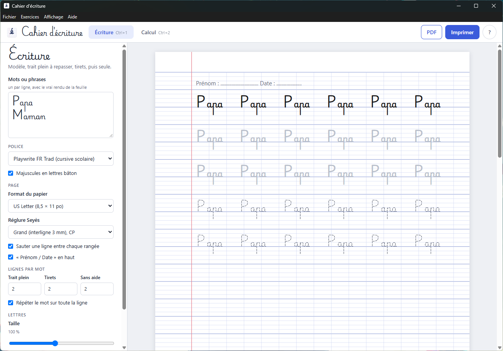
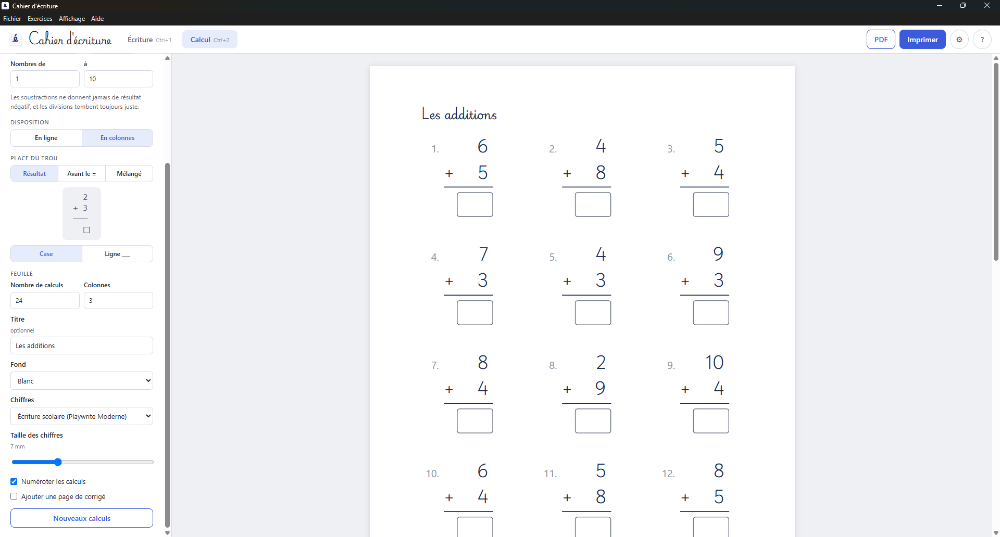
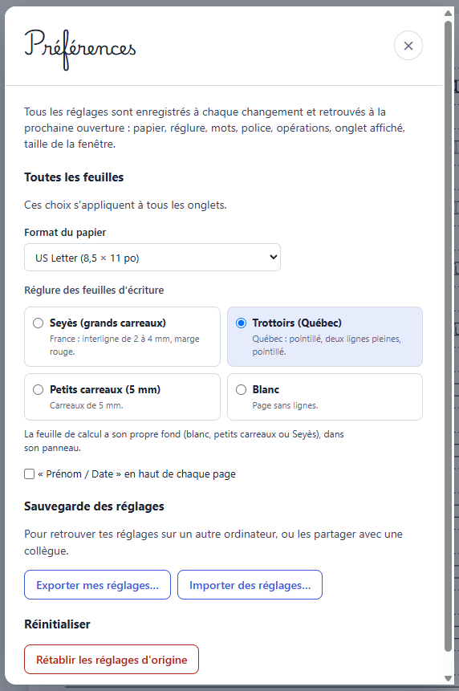

# Cahier d'écriture

Application Windows et macOS (Electron) qui prépare des feuilles d'exercices à imprimer pour apprendre à écrire et à calculer.

| Écriture | Calcul |
| --- | --- |
|  |  |
|  |  |

Les **Préférences** (⚙) règlent le papier, la réglure des feuilles d'écriture et l'en-tête « Prénom / Date » pour tous les onglets, et permettent d'exporter ou d'importer ses réglages :

## Télécharger

Dernière version : [page des Releases](https://github.com/ysaunier/cahier-ecriture/releases/latest).

| Système | Fichier |
| --- | --- |
| Windows (installation) | `Cahier-ecriture-installation.exe` |
| Windows (sans installation) | `Cahier-ecriture-portable.exe` |
| macOS (Intel et Apple Silicon) | `Cahier-ecriture-mac.dmg` |

L'application n'est pas signée. Sous Windows, SmartScreen demande une confirmation (« Informations complémentaires », puis « Exécuter quand même »). Sous macOS, fais un clic droit sur l'app, puis « Ouvrir » ; si macOS la dit endommagée : `xattr -cr "/Applications/Cahier d'écriture.app"`.

## Un problème, une question ?

- **Signaler un bug** : [ouvrir une issue](https://github.com/ysaunier/cahier-ecriture/issues/new?template=bug.yml) avec le modèle prévu. Depuis l'application, le menu **Aide › Signaler un problème…** remplit déjà la version et le système.
- **Proposer une idée** : [formulaire de suggestion](https://github.com/ysaunier/cahier-ecriture/issues/new?template=suggestion.yml), ou **Aide › Proposer une idée…** dans l'application.
- **Contact** : [contact@ysaunier.dev](mailto:contact@ysaunier.dev), ou **Aide › Nous écrire…** dans l'application.

## Exercices

| Onglet | Ce que fait la feuille |
| --- | --- |
| **Écriture** | Un mot par bloc : ligne modèle, trait plein gris à repasser, tirets qui suivent le chemin du crayon, lignes sans aide. Réglure Seyès (France) ou trottoirs (Québec), cursive scolaire liée, majuscules en lettres bâton. |
| **Calcul** | Opérations à trou (résultat ou terme manquant), en ligne ou posées en colonnes, case ou ligne, petits carreaux ou Seyès, corrigé sur une page à part. |

## Confidentialité et conditions

- **Aucun renseignement personnel n'est recueilli** : pas de compte, pas de statistiques, tout reste sur l'ordinateur. La seule connexion à Internet est la vérification des mises à jour, désactivable. Détails : [PRIVACY.md](PRIVACY.md).
- **Conditions d'utilisation** : logiciel fourni « tel quel », sans garantie ; l'adulte vérifie que les feuilles conviennent à l'enfant. Détails : [CONDITIONS.md](CONDITIONS.md).
- **Sécurité** : une faille se signale en privé, voir [SECURITY.md](SECURITY.md).

## Contribuer

Les idées de parents et d'enseignants sont les bienvenues via [Proposer une idée](https://github.com/ysaunier/cahier-ecriture/issues/new?template=suggestion.yml). Pour le code (installation, tests, organisation, publication d'une version), voir [CONTRIBUTING.md](CONTRIBUTING.md) et le [code de conduite](CODE_OF_CONDUCT.md).

## Licence

Le code est sous [licence MIT](LICENSE) : libre et gratuit, utilisable, modifiable et partageable, y compris en classe.

Les polices intégrées gardent leur propre licence (SIL Open Font License 1.1, voir `fonts/OFL.txt`).

## Crédits

Polices Playwrite FR Trad et Playwrite FR Moderne, © The Playwrite Project Authors (TypeTogether), licence SIL Open Font License 1.1.

## Auteur

Yoann Saunier — [github.com/ysaunier](https://github.com/ysaunier)

Si l'application te rend service, tu peux m'offrir un café :

