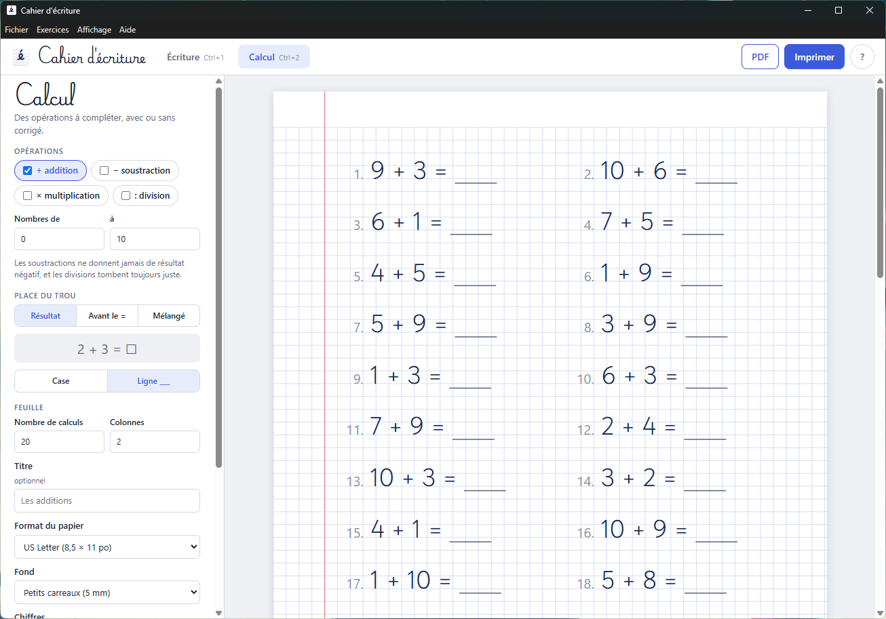
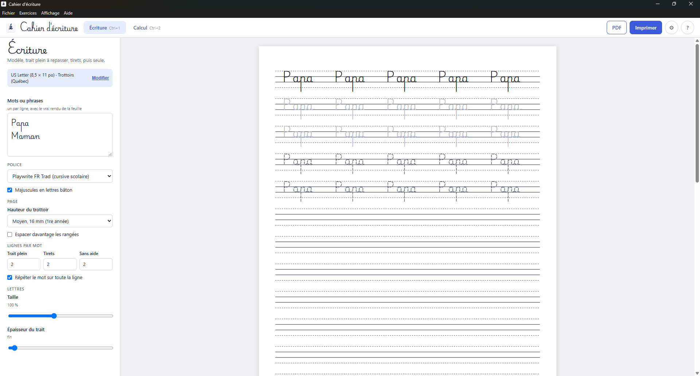

# Cahier d'écriture

[](https://github.com/ysaunier/cahier-ecriture/actions/workflows/ci.yml)
[](https://github.com/ysaunier/cahier-ecriture/releases/latest)

Application Windows et macOS (Electron) qui prépare des feuilles d'exercices à imprimer pour apprendre à écrire et à calculer.

| Écriture | Calcul |
| --- | --- |
|  |  |
|  |  |

Les **Préférences** (⚙) règlent le papier, la réglure des feuilles d'écriture et l'en-tête « Prénom / Date » pour tous les onglets, et permettent d'exporter ou d'importer ses réglages :


## Télécharger

Dernière version : [page des Releases](https://github.com/ysaunier/cahier-ecriture/releases/latest).

| Système | Fichier |
| --- | --- |
| Windows (installation) | `Cahier-ecriture-installation.exe` |
| Windows (sans installation) | `Cahier-ecriture-portable.exe` |
| macOS (Intel et Apple Silicon) | `Cahier-ecriture-mac.dmg` |

L'application n'est pas signée. Sous Windows, SmartScreen demande une confirmation (« Informations complémentaires », puis « Exécuter quand même »). Sous macOS, fais un clic droit sur l'app, puis « Ouvrir » ; si macOS la dit endommagée : `xattr -cr "/Applications/Cahier d'écriture.app"`.

## Un problème, une question ?

- **Signaler un bug** : [ouvrir une issue](https://github.com/ysaunier/cahier-ecriture/issues/new?template=bug.yml) avec le modèle prévu. Depuis l'application, le menu **Aide › Signaler un problème…** remplit déjà la version et le système.
- **Contact** : [contact@ysaunier.dev](mailto:contact@ysaunier.dev), ou **Aide › Nous écrire…** dans l'application.

## Exercices

| Onglet | Ce que fait la feuille |
| --- | --- |
| **Écriture** | Un mot par bloc : ligne modèle, trait plein gris à repasser, tirets qui suivent le chemin du crayon, lignes sans aide. Réglure Seyès (France) ou trottoirs (Québec), cursive scolaire liée, majuscules en lettres bâton. |
| **Calcul** | Opérations à trou (résultat ou terme manquant), en ligne ou posées en colonnes, case ou ligne, petits carreaux ou Seyès, corrigé sur une page à part. |

## Développer

```powershell
npm install
npm start
```

| Commande | Rôle |
| --- | --- |
| `npm run lint` | Vérifie le code (ESLint) |
| `npm test` | Tests unitaires (tirage des calculs, notes de version) |
| `npm run test:smoke` | Ouvre la vraie interface dans Electron et vérifie les deux exercices et l'export PDF |
| `npm run check` | Les trois à la suite |
| `npm run dist` | Construit les `.exe` Windows dans `dist/` |
| `npm run dist:mac` | Construit le `.dmg` macOS (sur un Mac uniquement) |

NSIS ne lit pas les chemins de plus de 260 caractères : si `npm run dist` échoue sur `extractAppPackage.nsh`, copie le projet dans un dossier au chemin court (par exemple `C:\dev\cahier`).

## Intégration et livraison continues

| Workflow | Quand | Ce qu'il fait |
| --- | --- | --- |
| [CI](.github/workflows/ci.yml) | chaque push sur `main` et chaque pull request | lint, tests unitaires, test de l'app sous Windows et macOS |
| [Release](.github/workflows/release.yml) | chaque tag `vX.Y.Z` | vérifie que le tag correspond au `package.json`, relance les tests, construit Windows et macOS, publie la Release avec les notes du CHANGELOG |
| [Dependabot](.github/dependabot.yml) | chaque semaine | propose les mises à jour d'Electron, des outils et des actions |

Lancé à la main depuis l'onglet Actions, le workflow Release construit seulement les fichiers (téléchargeables dans le résumé du run), sans rien publier. Avec un tag existant dans le champ « tag » (ex. `v1.2.0`), il construit ce tag et publie la Release, ou la complète si elle a été créée depuis l'interface web de GitHub. Un tag avec un tiret (`v1.2.0-beta.1`) publie une préversion.

### Publier une version

1. Ajouter une section `## X.Y.Z — date` en haut de `CHANGELOG.md`, et la même version dans la section « Nouveautés » de l'aide (`src/index.html`).
2. Changer la version, créer le commit et le tag, puis pousser :

   ```powershell
   npm version patch   # ou minor / major
   git push --follow-tags
   ```

3. Le workflow Release publie la Release quand les builds Windows et macOS ont réussi. Les tests refusent une version sans entrée dans le CHANGELOG ou dans l'aide.

## Organisation du code

```
main.js                fenêtre, menu, impression, PDF, « À propos »
preload.js             pont sécurisé entre la fenêtre et main.js
support.js             liens d'assistance : rapport de bug pré-rempli, courriel
src/index.html         interface : onglets, panneaux, aide
src/styles.css         styles, polices intégrées, règles d'impression
src/app.js             onglets, menu, impression, aide
src/lib/core.js        papier (Seyès, quadrillage), réglages mémorisés
src/lib/math-gen.js    tirage des calculs (aussi utilisé par les tests)
src/lib/skeleton.js    tirets sur la ligne médiane des lettres
src/exercises/         un fichier par exercice
test/unit/             tests unitaires (node:test)
test/smoke/            test de l'app complète dans Electron
scripts/               notes de version tirées du CHANGELOG
fonts/                 Playwrite FR Trad et Moderne (SIL OFL 1.1)
build/                 icône et écran de démarrage
```

### Ajouter un exercice

1. Créer `src/exercises/mon-exercice.js` qui appelle `Cahier.register({ id, label, init, render })`. Le papier et la réglure communs sont dans `Cahier.prefs`. Mettre la logique sans interface dans `src/lib/` pour pouvoir la tester comme `math-gen.js`.
2. Ajouter dans `src/index.html` un bouton d'onglet `tab-<id>` et une section `ex-<id>` (panneau `aside` + `main.pages`), puis la balise `<script>`.
3. Ajouter l'entrée dans `EXERCISES` de `main.js` pour le menu et son raccourci.
4. Ajouter des tests dans `test/unit/` et une vérification dans `test/smoke/smoke.js`.

## Licence

Le code est sous [licence MIT](LICENSE) : libre et gratuit, utilisable, modifiable et partageable, y compris en classe.

Les polices intégrées gardent leur propre licence (SIL Open Font License 1.1, voir `fonts/OFL.txt`).

## Crédits

Polices Playwrite FR Trad et Playwrite FR Moderne, © The Playwrite Project Authors (TypeTogether), licence SIL Open Font License 1.1.

## Auteur

Yoann Saunier — [github.com/ysaunier](https://github.com/ysaunier)

Si l'application te rend service, tu peux m'offrir un café :

[](https://buymeacoffee.com/ysaunier)
